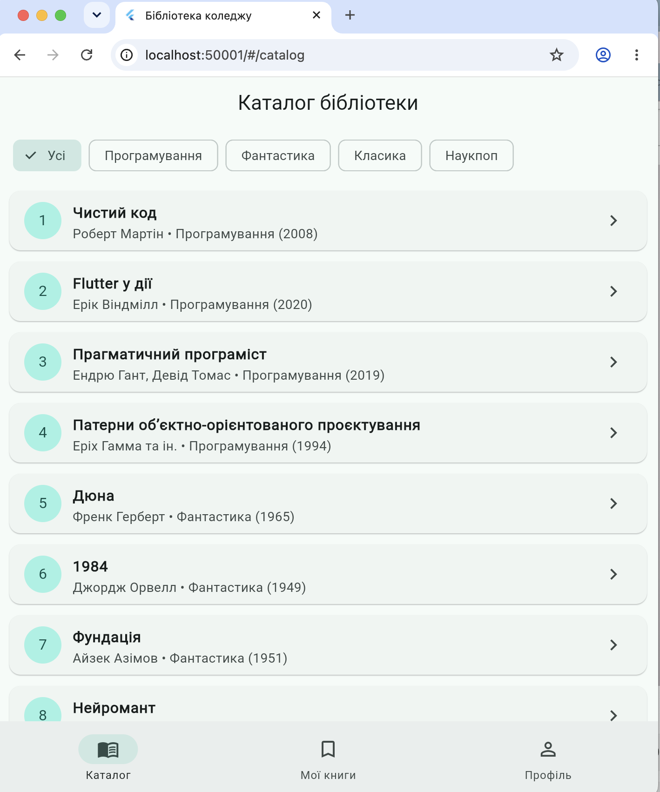
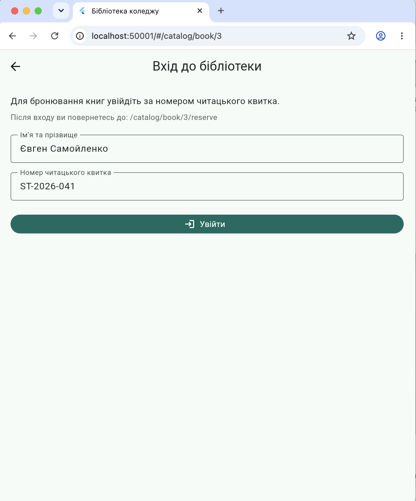
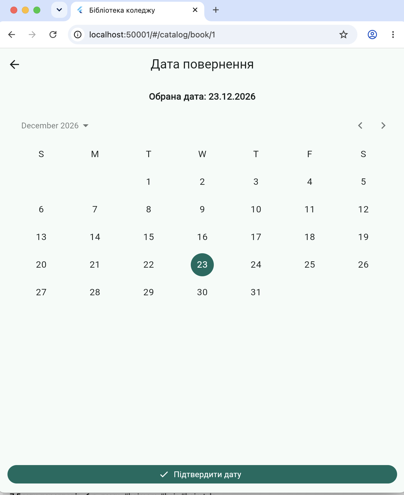
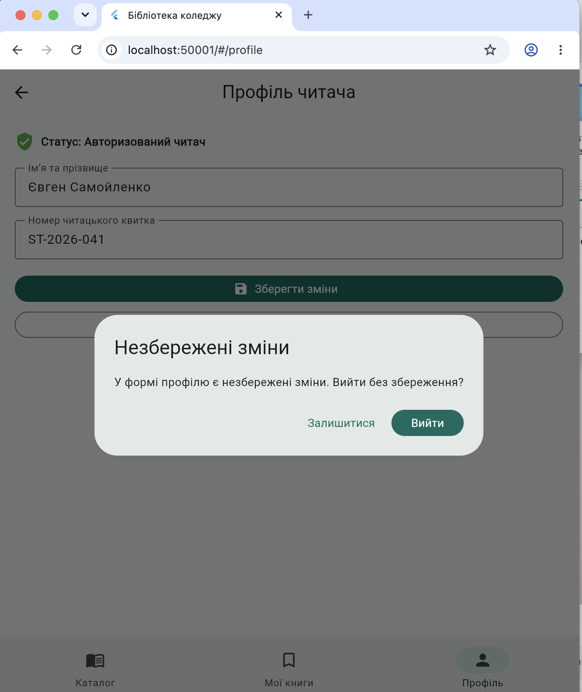

# Практична робота 7: Роутинг і навігація в Flutter

**Виконав:** Самойленко Є.  
**Варіант 1:** Бібліотека коледжу

## Опис проєкту та інструкція запуску

Мобільний та веб-застосунок «Бібліотека коледжу» з декларативною навігацією на базі `go_router` (`^17.0.0`). Реалізовано нижню навігацію зі збереженням стану вкладок (`StatefulShellRoute.indexedStack`), фільтрацію каталогу через параметри запиту, перегляд картки книги за параметром шляху, захист маршруту бронювання через `redirect` + `refreshListenable`, повернення результату вибору дати через `push<DateTime>` / `pop`, підтвердження виходу з незбереженими змінами через `PopScope`, обробку неіснуючих маршрутів (`errorBuilder`) та відкриття книги за власним deep link (`library://app/...`).

### Як запустити локально:
1. Клонувати репозиторій:
   ```bash
   git clone https://github.com/esamoylenko-wq/flutter-navigation-samoilenko.git
   cd flutter-navigation-samoilenko
   ```
2. Завантажити залежності та запустити:
   ```bash
   flutter pub get
   flutter run
   ```

---

## Карта маршрутів

```text
StatefulShellRoute.indexedStack (MainShellScreen: нижня панель навігації)
├── Вкладка 1: /catalog?genre=...          -> CatalogScreen (фільтр за жанром)
│   └── /catalog/book/:bookId             -> BookScreen (картка книги за ID)
│       └── /catalog/book/:bookId/reserve -> ReserveScreen [потрібен вхід, поверх нижньої панелі]
├── Вкладка 2: /my-books                  -> MyBooksScreen (список заброньованих книг)
└── Вкладка 3: /profile                   -> ProfileScreen (форма профілю з PopScope)

Кореневі маршрути (поверх нижньої панелі):
├── /login?from=...                       -> LoginScreen (вхід із поверненням на початкову адресу)
├── /select-date                          -> SelectDateScreen (повертає DateTime через context.pop)
└── будь-який невідомий шлях              -> errorBuilder (екран 404 з кнопкою «До каталогу»)
```

---

## Команди перевірки Deep Link

Власну схему `library://app/...` зареєстровано в `android/app/src/main/AndroidManifest.xml` та `ios/Runner/Info.plist`.

* **Для Android (через `adb`):**
  ```bash
  adb shell am start -W -a android.intent.action.VIEW -d "library://app/catalog/book/2" com.example.flutter_navigation_samoilenko
  ```
* **Для iOS Simulator (через `xcrun simctl`):**
  ```bash
  xcrun simctl openurl booted "library://app/catalog/book/2"
  ```

---

## Труднощі під час виконання та їх розв'язання

1. **Нормалізація адреси при відкритті custom deep link (`library://app/catalog/book/2`):** при передачі URL вигляду `library://app/...` у `GoRouter` сегмент `app` сприймається як хост (`uri.host == 'app'`), а шлях починається з `/catalog/book/2`. У функції `redirect` додано перевірку `uri.scheme == 'library' && uri.host == 'app'`, яка коректно перенаправляє на внутрішній шлях `/catalog/book/2` зі збереженням стека переходу до каталогу.
2. **Відображення екрана бронювання поверх нижньої панелі навігації:** оскільки маршрут `/catalog/book/:bookId/reserve` є дочірнім для гілки каталогу всередині `StatefulShellRoute`, для нього вказано `parentNavigatorKey: _rootNavigatorKey`, що дозволяє відкривати форму бронювання на весь екран поверх `NavigationBar`.
3. **Запобігання випадковій втраті даних у формі профілю:** реалізовано відстеження змін у контролерах полів та обгортку `PopScope` із `canPop: !_hasUnsavedChanges`, яка перехоплює спробу виходу та показує діалог підтвердження.

---

## Демонстрація сценаріїв (`docs/`)

### 1. Збереження стану вкладки «Каталог» при перемиканні вкладок


### 2. Перенаправлення неавторизованого користувача на екран входу (`redirect`)


### 3. Форма бронювання поверх нижньої панелі та вибір дати повернення


### 4. Підтвердження виходу з незбереженими змінами у профілі (`PopScope`)


---

## Декларація використання ШІ

* **Назва інструменту ШІ:** Gemini.
* **Мета використання:** Допомога в проєктуванні дерева маршрутів на базі `go_router` (`^17.0.0`), налаштуванні нативних конфігурацій deep link для Android та iOS, реалізації `StatefulShellRoute`, `redirect` із `refreshListenable` та `PopScope`.
* **Текстовий запит (промпт):** Поетапні запити щодо створення архітектури папок `models/state/screens`, реалізації каталогу книг, налаштування `GoRouter` із параметрами шляху та запиту, захисту маршрутів, конфігурації `AndroidManifest.xml` і `Info.plist` та виправлення автотесту `widget_test.dart`.
* **Фрагменти згенерованого контенту, що увійшли до роботи:** Базові шаблони моделей `Book` і `ReservedBook`, класу `LibraryState`, конфігурації `appRouter` у `lib/router.dart`, віджетів екранів у `lib/screens/` та блоків `<intent-filter>` / `CFBundleURLTypes` для deep link.
* **Опис власного доопрацювання:** Самостійно розгорнуто та налаштовано середовище розробки на macOS, створено репозиторій на GitHub, перевірено відсутність попереджень через `flutter analyze`, протестовано всі навігаційні сценарії у браузері, знято скріншоти для папки `docs/` та оформлено документацію.